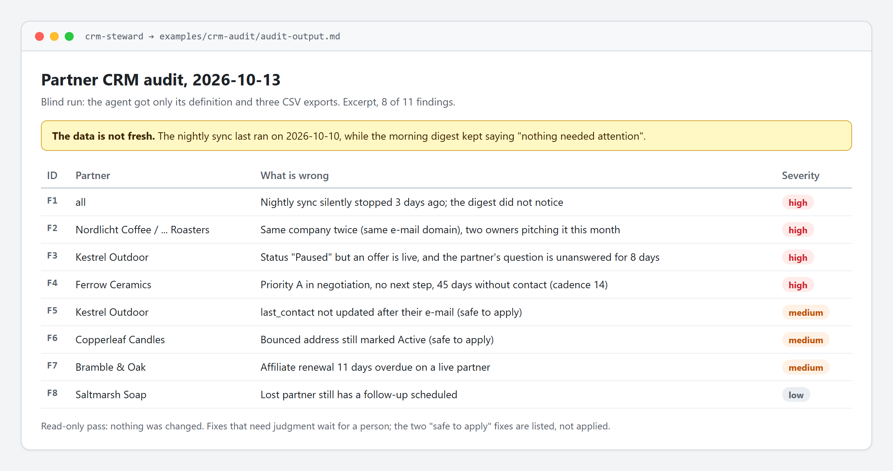

# AI Marketing Playbook

[](https://github.com/terezakohutova/ai-marketing-playbook/actions/workflows/check.yml)

Five patterns for letting an AI agent do real marketing and e-commerce operations work (outreach, listings, inventory, partner CRM, scheduled runs) without letting it publish, delete or spend on its own. Each one is written up from a workflow used in day-to-day operations, with the business taken out so the structure is what's left.

Two of them ship a working agent you can run in a couple of minutes, sample data with planted problems, the unedited output of blind runs, and a deterministic check that scores those runs against the written rules.

## Patterns

| Pattern | What it solves | Runnable |
|---|---|---|
| [Draft-first outreach](draft-first-outreach.md) | Let an agent write and stage outbound content across many channels, without giving it the job of publishing | |
| [Photo-to-multichannel listing](photo-to-multichannel-listing.md) | Turn one photoshoot into ready-to-review copy for every sales channel at once | |
| [Cross-platform inventory sync](cross-platform-inventory-sync.md) | Catch the moment something sells on one channel before it oversells on another | [agent](.claude/agents/inventory-sync.md), [sample](examples/sample-run/) |
| [Partner CRM steward](partner-crm-steward.md) | Keep a partner database honest: duplicates, contradicting statuses, missing next steps, cooling relationships, bounced contacts and silently dead automations | [agent](.claude/agents/crm-steward.md), [sample](examples/crm-audit/) |
| [Safe scheduled agents](safe-scheduled-agents.md) | Let an agent run every night or every week without quietly breaking things, and notice when it quietly stops running | |

## See one running



That is an excerpt of [`examples/crm-audit/audit-output.md`](examples/crm-audit/audit-output.md). The agent got its definition and three CSV exports of a fictional partner CRM with problems planted in them, and nothing that said what or where they were. Its first finding is the one that matters most: the nightly sync had silently stopped three days earlier while the daily digest kept reporting "nothing needed attention".

## Try it

The two agents are [Claude Code](https://claude.com/claude-code) subagents. Copy one into your own project and point it at the matching folder:

```bash
cp .claude/agents/crm-steward.md <your-project>/.claude/agents/
cp partner-crm-steward.md <your-project>/              # optional context the agent reads first
cp -r examples/crm-audit/ <your-project>/crm-export/
# then, in Claude Code: "audit the partner CRM export in crm-export/"
```

The same works for `inventory-sync.md` with `cross-platform-inventory-sync.md` and [`examples/sample-run/`](examples/sample-run/). Leave out the `*-output*.md` files if you want your run to be blind too, then compare.

## How the runs are checked

A model's own report is not proof, so there is a second, boring opinion. [`tools/reference_check.py`](tools/reference_check.py) applies each agent's written rules mechanically to the same CSVs and lists every finding the rules imply. It then checks that a run's output contains each of them (in the right section, for the right partner or item):

```bash
python tools/reference_check.py crm examples/crm-audit --today 2026-10-13 --against examples/crm-audit/audit-output.md
python tools/reference_check.py inventory examples/sample-run --against examples/sample-run/proposal-queue-output.md
python -m unittest discover -s tests -v    # also runs in CI on every push
```

Current results, all from fresh agents that never saw the expected answers:

| Run | Rule-derived findings caught |
|---|---|
| [Inventory sync](examples/sample-run/proposal-queue-output.md) | 7 of 7, and none of the 4 clean items flagged |
| [CRM audit, first run](examples/crm-audit/audit-output.md) | 14 of 14 |
| [CRM audit, second run](examples/crm-audit/audit-output-rerun.md) | 13 of 14 (missed one low-severity contact finding, documented in the file) |

The second CRM run is kept on purpose. Agents vary from run to run, which is exactly why the patterns put a person and a deterministic check after them rather than trusting one pass. The expected answers live in [`tests/`](tests/test_reference_checks.py), outside the example folders, so they don't leak into a run.

Standard library Python 3.9+ only, nothing to install.

## Principles behind all of them

- **The agent drafts, a human publishes.** Every pattern produces output a person reviews before anything goes live, and none of them give the agent posting, payment or delete rights. The two shipped agents enforce that with their tool list (`Read, Grep, Glob`), not just their prompt: they cannot change a file even if told to. Where a tool can't separate drafting from publishing (a logged-in browser), the pattern says so.
- **One pass, not one click.** The unit of work is a batch (a photoshoot, a day's sales, a list of prospects), not a single item, because that's the shape the human's actual week takes.
- **State lives in one place.** Each pattern writes to a single system of record instead of scattering status across channels, so "what's the current state of X" always has one answer.

## Stack

Built with [Claude Code](https://claude.com/claude-code) as the agent runtime, driving a mix of browser automation and existing business tools (inventory database, storefronts, marketplaces, CRM). The write-ups focus on the workflow shape rather than any specific integration, so the three patterns without a shipped agent are tool-agnostic on purpose.

## License

[MIT](LICENSE). Take the patterns and adapt them to your own stack.
