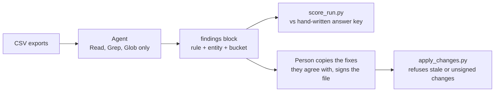

# AI Marketing Playbook

[](https://github.com/terezakohutova/ai-marketing-playbook/actions/workflows/check.yml)

A big share of marketing at a small brand is operations: the partner and
affiliate CRM, the same products listed on several marketplaces, outreach
drafts, and automations that run every night. These are five patterns for
handing that work to an AI agent without letting it publish, delete or
spend on its own. Two of them ship as working Claude Code agents, tested
blind against data they have never seen.

**The result:** on deliberately messy exports (renamed columns, three date
formats, free-text statuses) a rule-based script refuses the files or gets
findings wrong. The agent, applying the same written rules, caught every
planted finding with no wrong flags, in 3 of 3 blind runs per dataset.

## Try it in 30 seconds without Claude

Python 3.9 or newer, standard library only.

```bash
git clone https://github.com/terezakohutova/ai-marketing-playbook
cd ai-marketing-playbook
python tools/score_run.py --all
```

```
crm-1: precision 1.00 (13/13), recall 1.00 (13/13)
crm-2: precision 1.00 (11/11), recall 1.00 (11/11)
crm-3: precision 1.00 (11/11), recall 1.00 (11/11)
crm-messy: precision 1.00 (16/16), recall 1.00 (16/16)
inv-1: precision 1.00 (7/7), recall 1.00 (7/7)
inv-2: precision 1.00 (6/6), recall 1.00 (6/6)
inv-3: precision 1.00 (5/5), recall 1.00 (5/5)
inv-messy: precision 1.00 (9/9), recall 1.00 (9/9)

crm total: precision 1.00 (51/51), recall 1.00 (51/51)
inventory total: precision 1.00 (27/27), recall 1.00 (27/27)
```

That scores the committed agent runs against hand-written answer keys. Now
the same messy CRM export through the rule-based script:

```bash
python tools/reference_check.py crm examples/crm/crm-messy
```

```
error: partners.csv: missing column(s) partner_id, name, status, priority, owner, market, next_step, next_step_date, last_contact, live_offers
```

And a scheduled automation that quietly broke, caught from its run log:

```bash
python tools/run_log_check.py examples/scheduled/broken
```

```
S1  nightly-sync                             no run on 2026-10-11
S1  weekly-heartbeat                         weekly runs: ['2026-10-02']
S2  nightly-sync/partners.status             2026-10-03: not on may_write ['contacts.status', 'partners.last_contact', 'partners.live_offers']
S3  nightly-sync/partners                    2026-10-04: create P11 (from an inbound e-mail)
S4  nightly-sync/partners.last_contact       2026-10-06: wrote '2026-10-06' without the old value
S5  morning-digest/2026-10-12                digest sent with 0 items

6 findings.
```

## Patterns

| Pattern | What it solves | What ships |
|---|---|---|
| [Cross-platform inventory sync](cross-platform-inventory-sync.md) | Compare every sales channel's export with one source of truth and queue what is stale or oversold, for a person to confirm | **Runnable:** [agent](.claude/agents/inventory-sync.md), 3 clean + 1 messy dataset, blind runs, scorer |
| [Partner CRM steward](partner-crm-steward.md) | Keep a partner database honest: duplicates, contradicting statuses, missing next steps, cooling relationships, bounced contacts and silently dead automations | **Runnable:** [agent](.claude/agents/crm-steward.md), 3 clean + 1 messy dataset, blind runs, scorer, [apply step](examples/apply/) |
| [Safe scheduled agents](safe-scheduled-agents.md) | Let an agent run every night without quietly breaking things, and notice when it stops running | **Runnable check:** [run-log checker](tools/run_log_check.py) with a [healthy and a broken log](examples/scheduled/) |
| [Draft-first outreach](draft-first-outreach.md) | Let an agent write and stage outbound content across many channels without giving it the job of publishing | **Runnable check:** [queue checker](tools/outreach_check.py) (approval before send, approved text = sent text, cooldown, exclusions) with an [example queue](examples/outreach/) |
| [Photo-to-multichannel listing](photo-to-multichannel-listing.md) | Turn one photoshoot into ready-to-review copy for every sales channel | Design note only |

## How it fits together



The agent only reads. Its output ends in a machine-readable findings block,
which is what gets scored in testing and what a person picks from in real
use. Applying a change is a separate step a person starts.

## Results

Every run is a fresh, non-interactive Claude Code session (model: sonnet)
in an empty folder holding only the agent definition and the dataset's
CSVs, with only the Read, Grep and Glob tools, made with
[`tools/blind_run.py`](tools/blind_run.py) on 2026-10-14. The agent never
sees the dataset README, the answer key or the checker, and its prompt
contains no string from any dataset (a test enforces that). Outputs are
unedited; each `run.json` has the command, prompt and file hashes, and a
test checks the hashes.

**Messy data, where the agent has to add something:**

| Dataset | What makes it messy | Rule-based script | Agent |
|---|---|---|---|
| [crm-messy](examples/crm/crm-messy/) (16 findings) | Renamed and extra columns, dates as `2026-11-20`, `19.11.2026` and `Nov 18 2026`, free-text statuses, an e-mail logged under an unusual channel name, a bounce whose first address is the mail server, the real signal in a notes column | Refuses the raw files. With headers renamed by hand it stops at the first non-ISO date. With dates converted too, it misses 3 findings and adds 2 wrong ones | 16 of 16, no wrong flags, in [each](examples/runs/crm-messy/output.md) [of](examples/runs/crm-messy/repeats/run-2/output.md) [3 runs](examples/runs/crm-messy/repeats/run-3/output.md) |
| [inv-messy](examples/inventory/inv-messy/) (9 findings) | Different column names in every file, free-text statuses, multi-unit stock spread across channels, notes that matter | Refuses the raw files. With headers renamed by hand it misses 4 of the 9 findings and adds 4 wrong ones | 9 of 9, no wrong flags, in [each](examples/runs/inv-messy/output.md) [of](examples/runs/inv-messy/repeats/run-2/output.md) [3 runs](examples/runs/inv-messy/repeats/run-3/output.md) |

**Clean data** (one run each): [inv-1](examples/runs/inv-1/output.md) 7/7,
[inv-2](examples/runs/inv-2/output.md) 6/6, [inv-3](examples/runs/inv-3/output.md) 5/5,
[crm-1](examples/runs/crm-1/output.md) 13/13, [crm-2](examples/runs/crm-2/output.md) 11/11,
[crm-3](examples/runs/crm-3/output.md) 11/11, all with no wrong flags. The script
gets these right too, so they show rule-following, not added value.

**Misses.** None in the current runs. The one miss on record is from an
earlier run, whose prompt quoted strings from the messy datasets (now
removed; that run is in git history): it missed E2 on P05 in crm-messy.
The hand-written key had missed it too. The script caught it, and the key
was corrected, as recorded in the key's `revisions` field.

**Limits.** The datasets are small (9 to 12 entities each), the messy
cases were planted by the person who wrote the rules, and three runs is a
small sample. A real export will be messy in ways nobody planned. That is
why every pattern puts a person and a deterministic check after the agent.

Here is an excerpt of the scored crm-messy run. The agent states how it
mapped the columns, then reports each finding with its evidence:

```
**Column mapping:**
- `stage` = status
- `prio` = priority
- `account_owner` = owner
...
I read dates in several formats. I mapped `live-ish (soft launch)` to Live, `Paused till Feb` to Paused, and `LOST` to Lost.

| ID | Rule | Partner | What's wrong | Evidence | Severity | Proposed fix (who decides) |
| 1 | A1 | nightly-sync | The job has no log line on one day. | It runs daily from 2026-11-14 to 2026-11-20 but nothing is logged for 2026-11-18. ... | high | Check why the 18 Nov sync didn't run. (person) |
| 2 | B1 | P02+P07 | Near-same names and a shared company domain. | "Kettle & Crumb" and "Kettle and Crumb Ltd." both normalise to "kettle crumb". ... | high | Decide whether to merge them. (person) |
| 12 | E1 | C09 (P09) | A contact whose address bounced is still Active. | 2026-11-16 notice: Final-Recipient `jo@wrenwillow.example`. The sender `postmaster@mx…` is only the server. ... | medium | Set C09 to To verify or Former. (safe to apply) |
```

## How the runs are checked

1. **Rules with ids.** Each agent definition has a rule table (CRM: A1 to F4, inventory: I1 to I6) saying when a finding fires, what entity it is about and who decides the fix. One finding is one (rule, entity) pair.
2. **A machine-readable block.** The agent ends its output with a fenced `findings` block, a JSON list of `{"rule", "entity", "bucket"}`. Only that block is scored.
3. **Answer keys written by hand** in [`tests/answer_keys/`](tests/answer_keys/), with the expected findings and near-misses that must not be flagged, outside the input folders. Every rule has at least one positive and one negative case across the keys.
4. **A rule-based checker**, [`tools/reference_check.py`](tools/reference_check.py), applies the written rules to clean CSVs as a second opinion. [`tools/key_vs_checker.py`](tools/key_vs_checker.py) lists every finding only one of them has, and the tests pin that per dataset.
5. **A scorer**, [`tools/score_run.py`](tools/score_run.py), reports precision and recall, overall and per rule. Wrong flags, wrong buckets, unknown rules and catch-all entities ("all", "P01-P10") count against precision, and the tests show that a block flagging everything scores badly.

```bash
python -m unittest discover -s tests -v
python tools/score_run.py --all --per-rule
python tools/key_vs_checker.py
```

CI runs these on Python 3.9 and 3.13, on Ubuntu and Windows, plus
[ruff](https://docs.astral.sh/ruff/).

## Run an agent yourself

The two agents are [Claude Code](https://claude.com/claude-code) subagents.
Copy one into your own project and point it at a dataset:

```bash
cp .claude/agents/crm-steward.md <your-project>/.claude/agents/
mkdir -p <your-project>/crm-export && cp examples/crm/crm-2/*.csv <your-project>/crm-export/
# then, in Claude Code: "audit the partner CRM export in crm-export/"
python tools/score_run.py tests/answer_keys/crm-2.json <your saved output>.md
```

Copy only the CSVs to keep the run blind. To repeat a committed run exactly
as it was made: `python tools/blind_run.py crm-2 --work-dir <run-dir>`.

## Principles behind all of them

- **The agent drafts, a human publishes.** No pattern gives the agent posting, payment or delete rights. The two shipped agents have `Read, Grep, Glob` in their tool list, which Claude Code enforces, so they can't change a file even if told to. Copy the prompt without the tool list and the guarantee doesn't come with it.
- **Audit and apply are separate steps.** A person copies the proposals they agree with into a changes file with their name on it, and [`tools/apply_changes.py`](tools/apply_changes.py) applies it: it refuses anything stale, unsigned or two changes to one field, replaces each file atomically and keeps a journal so a half-finished apply is noticed ([example](examples/apply/)).
- **One pass, not one click.** The unit of work is a batch (a photoshoot, a day's sales, a list of prospects), because that is the shape of the actual week.
- **One answer to "what's the current state".** Each pattern names one system of record (the storefront for stock, the CRM for partners, the run log for automations) and compares everything else against it.

## License

[MIT](LICENSE). Take the patterns and adapt them to your own stack.
